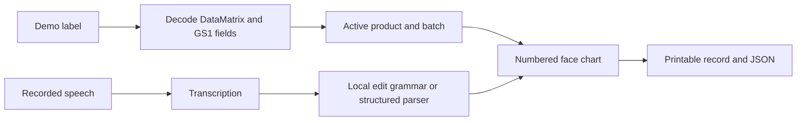

# Charted

Voice-assisted injection charting: scan a demo product label, dictate sites and amounts, adjust numbered points, and print a treatment record with batch details.

Built for the [DevDay Exchange Community Hackathon, London](https://luma.com/dde-ldn-hack), 1 November 2026, by Shane McKeown with Codex.

**Status:** repository and build brief prepared. Application implementation has not started. This README will be updated with verified setup instructions and working links as milestones finish.

## Who it's for and the problem

Aesthetic practitioners need to record treatment sites, amounts and product batches. Charted explores recording those details by voice while keeping the practitioner in control of the chart.

The demo uses a fixed face outline and synthetic labels named **Botox** and **Filler**. The practitioner supplies every site and amount; the app does not recommend treatments or doses.

## Demo video link

Pending: a working demo video of no more than 90 seconds. The final link must open without a permission request.

## Live demo

Pending: a public demo URL. No working hosted application is claimed yet.

## How to run

The repository currently contains documentation only; there is no runnable app or package manifest yet.

After scaffolding, this section will contain tested installation, environment setup, development, build and test commands. Keep `OPENAI_API_KEY` server-side in a local ignored environment file; `.env.example` contains only a blank placeholder.

The planned `/demo-label` page will display real generated GS1 DataMatrix barcodes on a phone or laptop for scanning with the other device. PNG upload will provide a fallback.

## How it works

Planned flow:

Movement uses explicit commands such as “move point 5 up 3 steps”. Deletion first asks “Are you sure?” and requires a separate second delete command. Each point preserves its product and batch when another label is scanned.

## How Codex helped

See [CODEX_LOG.md](CODEX_LOG.md) for dated milestones, actual problems and fixes, documentation sources and verification results. Before submission, this section will identify one concrete implemented and tested example.

## Built today vs existing

- **Before the 11:00 build window:** idea, domain knowledge, build brief and repository preparation. No application implementation is included in the initial commit.
- **During the build window:** implementation milestones and commits will be recorded in the log.
- **Existing project code:** none copied into this repository. The brief uses field names intended to ease a later Aestheticc integration; the hackathon app is standalone.
- **Existing code and assets:** no libraries have been installed and no artwork has been added yet. Planned dependencies are Next.js, React, TypeScript, Tailwind CSS, the OpenAI Node SDK, zxing-wasm, bwip-js and Vitest. Record installed versions, upstream sources and verified licences here when they are added, along with any other templates or assets actually used.
- **Author contribution:** concept, clinical workflow knowledge, product decisions and demo by Shane McKeown; implementation assistance by Codex.

## Synthetic data notice

All demo identities, barcode fixtures and batches are synthetic. “Botox” and “Filler” are display categories for the demo, not proof of a genuine product's identity. Generated labels must visibly say “SYNTHETIC DEMO PRODUCT · NOT FOR CLINICAL USE”. No patient records, private Aestheticc code, credentials or real clinical data belong in this repository or demo.

## Limitations

This is a hackathon demonstration, not a validated clinical record system. The planned app has one local browser session, no accounts or database, and no real product catalogue. Voice processing requires network access and an API key. Clinical advice and dose suggestions are outside scope.

## Build and submission

The [build brief](docs/CODEX_BRIEF.md) defines the journey and acceptance checks. The [submission checklist](SUBMISSION_CHECKLIST.md) tracks remaining deliverables and distinguishes verified event details from the supplied brief.
